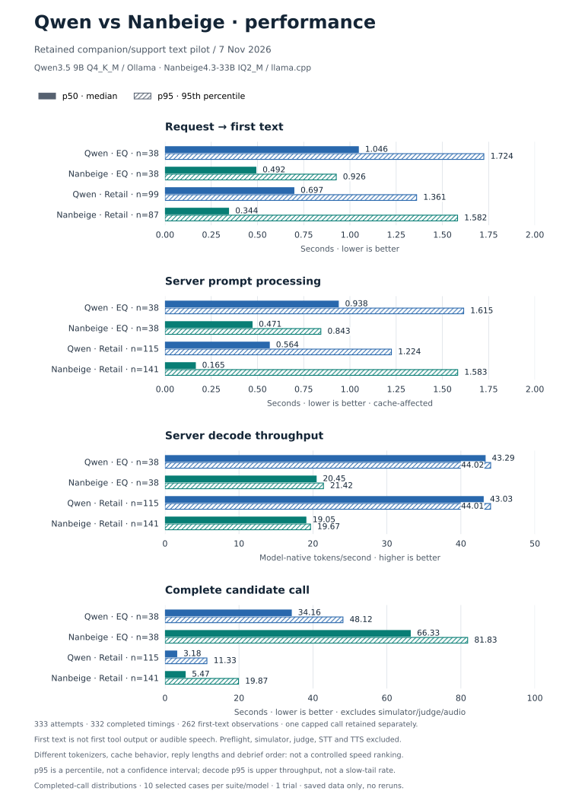

# Local Voice

An English-only voice playground. Talk through **your browser's microphone and speaker**; inference runs on your GPU computer.

**Next.js + Pipecat SmallWebRTC + Parakeet + local Ollama LLM + Phonon.** No LiveKit server, Daily room, hosted inference, Whisper, cloud API key, database, or recording. The Python agent is the direct WebRTC peer; there is no separate media-server service.

Optional CPU ASR comparison: [Needle + Whistle](docs/whistle.md). Parakeet remains the default; this experiment is a model-quality tradeoff to measure, not a promised equivalent.

**Current local LLM selection (2026-11-08): Nanbeige4.3-33B IQ2_M.** We chose
to try it for the companion use case after a higher custom EQ rubric mean
(5.57/20 vs Qwen's 4.30/20), with retail outcomes tied at 8/10. This small text
pilot does not prove better voice quality or latency. See [why we switched,
evidence, setup, and rollback](docs/nanbeige.md#why-we-changed-llms--2026-11-08).
Portable defaults remain Qwen; the local service was verified and left stopped.


EQ averages and retail outcomes are different metrics, not a combined score.
[Detailed comparison and chart provenance](benchmarks/companion-support-2026-11-07/COMPARISON.md).



Solid = p50; hatched = p95. [Performance definitions, prompt/cache chart and saved evidence](benchmarks/companion-support-2026-11-07/PERFORMANCE.md).
These are text-call distributions with different tokenizers/cache behavior,
not measured audible latency or a controlled speed ranking.

**Repository scope:** [LLM benchmarks and charts live here](benchmarks/README.md).
Custom TTS training, fine-tuning/LoRA and non-speech/animal-sound research live in
[ideas/expressive-voice-models](https://github.com/gianpaj/ideas/tree/master/expressive-voice-models).

Measured native optimization: [resident Parakeet](docs/native-inference.md)
keeps the same checkpoint/precision in a supervised CUDA worker. The controlled
comparison measured **487.6 → 52.3 ms median STT**, with **35/35 exact output
matches**. CLI remains the portable default/rollback; this tested host uses
resident mode in its private local configuration. [Measured results](docs/native-inference-results-2026-11-05.md).

Interactive component comparison: open **`/performance`** on the running app,
or generate the standalone offline HTML from the [curated results snapshot](reports/data/performance-2026-11-05.json):

```bash
pnpm report reports/data/performance-2026-11-05.json
```

The report includes STT quality/latency, native mel/encoder/decoder timings,
LLM/TTS observations, browser acceptance and the isolated Rustvani experiment,
with per-fixture drill-down and JSON/CSV downloads. [Report guide](reports/README.md).

## Quick start

Requires Linux, an NVIDIA GPU/CUDA-capable `transcribe.cpp`, Python 3.12 via [uv](https://docs.astral.sh/uv/), Node 24, pnpm 11.16.0, existing named model weights, and loopback Ollama. Tested with a 16 GB RTX 4060 Ti.

```bash
pnpm setup
# Edit .env to reference your existing local binary/model paths.
pnpm preflight
pnpm dev
```

Open **http://localhost:3000** on the same computer. Wait for model warmup, click Start talking, and allow microphone access. Stop clears the conversation. Ctrl+C stops both project services, not Ollama. Setup preserves an existing `.env` and installs from committed lockfiles.

On another tailnet device use private **Tailscale HTTPS**, not plain HTTP to an IP. Run `pnpm build` then `pnpm start` for this shared handoff; `pnpm dev` is for local development. Production mode avoids the dev server's HMR/cross-origin WebSocket. The browser supplies that device's audio, not host-attached devices. See the [runbook](docs/runbook.md).

## Models

- Parakeet TDT 0.6B v3 Q8_0: **739 MB**, matching Handy CUDA runner. Utterance-level recognition after VAD, not live partial STT; pause at least every 30 seconds.
- Nanbeige4.3-33B IQ2_M through Ollama: **12.2 GB** weights, selected in the installed deployment as `local-voice-nanbeige`. Reuses the benchmarked checkpoint; requires an explicit project checkpoint-size override. See [setup and rationale](docs/nanbeige.md).
- Qwen3.5 9B Q4_K_M through Ollama: **6.6 GB** weights. Retained as portable default/rollback, using `local-voice-qwen`. Both configurations use 4,096 context and 128 output tokens, warmed before ready; no automatic pulls.
- Phonon 31M English Q8_0: **64.5 MB** weights, about 65 MB selected snapshot. Kept loaded on CPU with four threads and 24 kHz PCM streaming.

The original Qwen stack keeps each checkpoint below 8 GB; Nanbeige deliberately
opts into a larger LLM checkpoint without changing the STT/TTS limits. Runtime
allocation is not checkpoint size. Phonon stays on CPU to leave GPU room for the
LLM and Parakeet. See [acquisition and licenses](docs/models.md).

## One concurrent call: measured performance

**Historical Qwen baseline, 2026-11-06 — not Nanbeige performance.** One active
browser call at a time, with warmed local models.
This is an observed workload on the following computer, not a minimum-spec claim
or a multi-call capacity benchmark.

| Hardware / software | Configuration |
| --- | --- |
| CPU | AMD Ryzen 5 7600X — 6 cores / 12 threads |
| GPU | NVIDIA GeForce RTX 4060 Ti — 16 GB VRAM (16,380 MiB reported) |
| RAM | 29.7 GiB visible to the OS |
| OS / GPU driver | Ubuntu 26.04 LTS / NVIDIA 595.91.07 |
| Framework | Pipecat 1.15.0, SmallWebRTC |
| STT | Resident Parakeet TDT 0.6B v3 Q8_0 on CUDA, four threads |
| LLM | Ollama Qwen3.5 9B Q4_K_M; 4,096 context / 128 output tokens |
| TTS | Phonon 31M English Q8_0 on CPU, four threads |

The snapshot covers **11 completed turns** from mixed manual sessions and browser
smoke tests since 19:00 UTC, reviewed at 19:37 UTC. Three interrupted turns and two
disconnected turns are retained in the logs but excluded from this completed-turn
table. A turn can produce multiple TTS segments, so segment counts differ.

| Measured interval | Samples | Median | p95 | Maximum |
| --- | ---: | ---: | ---: | ---: |
| STT request → completed transcription | 11 requests | 92.8 ms | 136.7 ms | 139.3 ms |
| LLM request → first answer token | 11 requests | 206.2 ms | 283.2 ms | 312.4 ms |
| TTS request → first generated PCM chunk | 27 segments | 16.5 ms | 61.3 ms | 67.5 ms |
| VAD stop notification → first generated response PCM | 11 turns | **436.2 ms** | 2,062.5 ms | 3,453.4 ms |

**Interpretation:** the 436 ms median is server-side agent TTFA, not the time from
the user's last word to hearing a reply. It excludes the earlier configured
**600 ms silence-detection window**, network transit, browser buffering and speaker
latency. Generated PCM can include leading silence; actual audible onset is not
measured. Do not sum stage medians or p95s to infer end-to-end latency.

The slowest turn included an approximately **2.9-second gap between STT completion
and LLM request start**; its cause is not yet confirmed. With only 11 completed
turns and mixed prompts/transports, p95 is descriptive, not a production SLO.
Multi-call throughput, cold-start latency and remote acoustic latency are not
established by this snapshot. [Machine-readable aggregate](reports/data/single-call-performance-2026-11-06.json).

### Local timing logs

Per-request timings, turn outcomes, model/configuration labels and sanitized
OpenTelemetry spans are saved to **`.local/metrics/metrics.jsonl`**, without
conversation text or audio. Files rotate at approximately **10 MB**, retaining
five backups; `.local/` is ignored by Git. The reviewed writer reported **zero
dropped records and zero write errors**. This aggregate contains no raw dialogue,
recording, private machine paths or session identifiers.

```bash
pnpm metrics
pnpm metrics --since 2026-11-06T19:00:00Z --format json
pnpm metrics --format csv > .local/timings.csv
```

The analyzer excludes duplicate span representations and separates outcomes.
Commands analyze the current retained logs; the linked aggregate freezes the
numbers above. See [observability and exact timing boundaries](docs/observability.md).

## Recorded two-agent conversation

The runnable [Vicky ↔ John example](examples/two-agent-conversation/README.md)
preserves the exact generator used for the two-minute recording: distinct Phonon
voices, separate system prompts and accumulated histories, and PCM → Parakeet
handoffs instead of passing the other agent's generated text directly. It saves
audio, transcripts and timing evidence locally; it is not a multi-call benchmark.

## Checks

```bash
pnpm test
pnpm typecheck
pnpm build
uv run --project apps/agent python -m local_voice.check --smoke
```

The smoke command synthesizes public test speech, transcribes it locally and warms Qwen. No private recording is required. Debug the apps separately:

```bash
uv run --project apps/agent python -m local_voice.server
pnpm --filter web dev
```

## Boundaries

One browser session at a time; another receives busy instead of taking over. Start/Stop, mute, microphone/speaker selection, transcript and turn states are included. Barge-in cancels the LLM, asks the native Phonon worker to stop, discards stale PCM generations and flushes transport playback.

No persistent audio/conversation store is enabled. Browser transcript is capped at 60 entries; backend history is bounded and discarded at disconnect. Temporary STT WAV/text files are deleted on success/failure/cancel. Routine logging contains metadata, not speech. There is no cloud fallback.

Timing metadata **is** retained locally: per-request STT/LLM/TTS measurements, per-turn latency and sanitized OpenTelemetry spans, without conversation content. Run `pnpm metrics` for outcome-separated p50/p95 reports or CSV/JSON export. See [observability and timing definitions](docs/observability.md), and the [performance research backlog](docs/performance-research-2026-11-05.md) for optimizations that preserve the current models.

Local automated WebRTC checks do not verify physical audio or remote-device networking. [Verification](docs/verification.md) records what actually passed and what still needs the intended user's microphone/speaker test.

Source: [gianpaj/local-voice-agent](https://github.com/gianpaj/local-voice-agent), a private repository published at the user's request. Model weights and local runtime configuration are not included. The implementation adapts the official [Pipecat P2P voice example](https://github.com/pipecat-ai/pipecat-examples/tree/7875d02bc0714d59528b0c8797664308af960a3a/p2p-webrtc/voice-agent), replacing Gemini/public STUN. See [notices](THIRD_PARTY_NOTICES.md), [design](docs/superpowers/specs/2026-11-04-local-voice-agent-design.md), and [plan](docs/superpowers/plans/2026-11-04-local-voice-agent-implementation.md).
