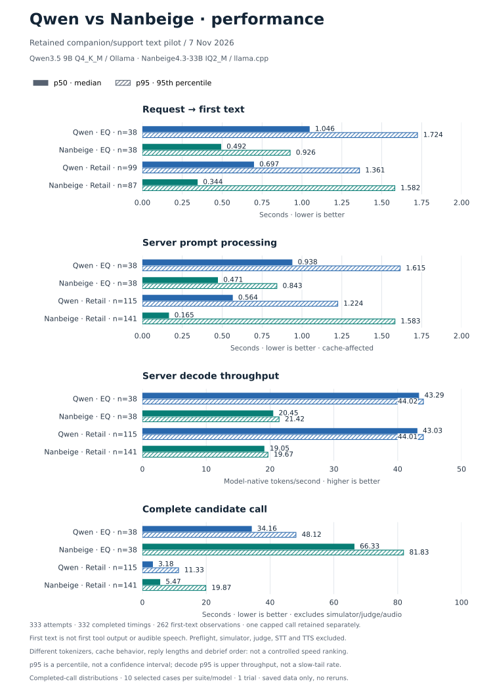

# Voice-agent benchmarks

This repository is the canonical home for local voice-agent LLM selection,
Qwen–Nanbeige comparisons, benchmark fixtures/results, timing evidence and charts.
Custom TTS model training, LoRA, dataset preparation and non-speech/animal-sound
synthesis research live separately in
[ideas/expressive-voice-models](https://github.com/gianpaj/ideas/tree/master/expressive-voice-models).

## Qwen versus Nanbeige — 2026-11-07

- [Audited quality comparison, failures and matching limits](companion-support-2026-11-07/COMPARISON.md)
- [First-text, prompt/cache, decode and p50/p95 performance](companion-support-2026-11-07/PERFORMANCE.md)
- [Fixtures, runtime settings, evaluator route and replay instructions](companion-support-2026-11-07/README.md)
- [Original benchmark-selection research](../docs/benchmark-selection-2026-11-07.md)
- [Migration source revision and per-file preservation hashes](companion-support-2026-11-07/MIGRATION.json)




These are custom ten-case text pilots, not official scores or audio latency.
Quality, support outcomes and performance are distinct metrics. Missing/capped
calls remain auditable; incompatible cache/tokenizer accounting is not ranked
as matched prefill throughput. Nothing was rerun during the repository move.

The [existing component-performance report](../reports/README.md) covers the
separate STT/TTS/pipeline experiments; it is not relabeled as this LLM pilot.

## Reproduce charts without inference

From the repository root, with Matplotlib available:

```sh
python3 benchmarks/companion-support-2026-11-07/plot-comparison.py
python3 benchmarks/companion-support-2026-11-07/performance-evidence.py
python3 benchmarks/companion-support-2026-11-07/plot-performance.py
```

The aggregation script is standard-library only. Its optional archive-export
mode reads saved files; none of these commands runs a model or starts a service.
